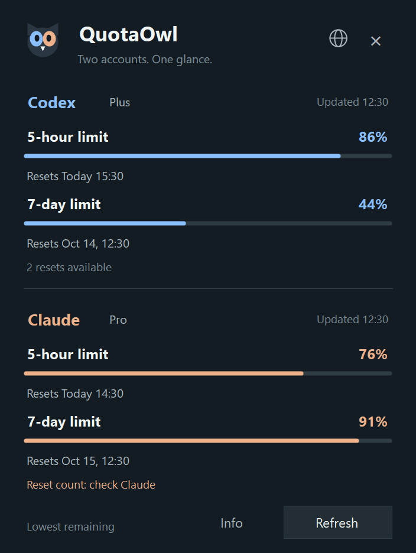

# QuotaOwl 🦉

**Codex and Claude usage, one number in your Windows taskbar.**

A lightweight Windows system tray monitor for your AI subscription limits. See the lowest remaining quota without keeping a terminal or browser tab open.

[简体中文](README.zh-CN.md) · [Download Windows ZIP](https://github.com/flymm004/quotaowl/releases/download/v0.2.0-alpha.3/QuotaOwl-0.2.0-alpha.3-win-x64.zip) · [Release notes](https://github.com/flymm004/quotaowl/releases/tag/v0.2.0-alpha.3) · [Report an issue](https://github.com/flymm004/quotaowl/issues)

> **Preview release: 0.2.0-alpha.3.** Claude usage relies on an internal client interface that may change. Older Codex Usage Monitor releases support Codex only.

## At a glance

*Rendered from the current Windows interface using sample data, not a real account.*

*The single tray badge: 44% remaining in Codex's weekly window in this example.*

- **One tray number:** the lowest remaining percentage across both services' 5-hour and weekly limits.
- **Blue for Codex, orange for Claude:** the color follows the service behind that number.
- **Hover for all four values; click for the panel:** see reset times, account status, and Codex reset credits together.
- **Refresh every 2 minutes:** independent provider reads, manual refresh, and a warning when a limit first falls below 20%.
- **Eight languages:** English, Simplified Chinese, Traditional Chinese, Japanese, Korean, Spanish, German, and French; system language supported.
- **Native Windows UI:** per-monitor DPI support, no installer, no administrator privileges, and no package dependencies.

## Download and run

1. Open [Releases](https://github.com/flymm004/quotaowl/releases) and expand **Assets** on a QuotaOwl release.
2. Download **QuotaOwl-version-win-x64.zip**. You do not need the **Source code** downloads.
3. Right-click the ZIP, choose **Extract All**, and open the extracted folder.
4. Double-click **QuotaOwl.exe**. Keep **QuotaOwl.exe.config** beside it for high-DPI support.
5. Find the number beside the taskbar clock. If hidden, open the tray overflow menu and drag the icon onto the taskbar.

Closing the panel keeps QuotaOwl running. Right-click the icon and choose **Exit** to quit. The single-instance guard also prevents older Codex Usage Monitor versions from running alongside it.

### Requirements

- Windows 10 or 11, x64, with .NET Framework 4.8.
- For Codex: installed CLI or desktop runtime, signed in with a ChatGPT subscription.
- For Claude: Claude Code signed in with an official subscription (**claude auth login**). The terminal can be closed afterward.
- Network access to the quota services. Either provider can be used independently.

## What does the number mean?

If Codex has **86% / 44%** remaining and Claude has **76% / 91%**, the tray shows **44** in blue. It compares percentages; the services' credits are not combined or interchangeable.

Hover labels use **5h** and **7d**; **\*** marks the window shown in the tray. An amber dot indicates a low limit or a failed read. Right-click to see which service and window the number represents.

Transient failures retain the last successful values in memory, marked as outdated in the panel and hover text. **!** marks a provider without readable data. Sign-out or an unsupported provider configuration clears that provider's values. With one provider unavailable, the number is the minimum of available readings; with no readings it shows **—**, never an invented zero.

## Data sources and limitations

**Codex:** queries the locally installed CLI App Server using its existing sign-in. Prefers the current versioned desktop runtime over an obsolete root binary. Displays reset credits when returned; a missing count is unknown, not zero.

**Claude:** reads the existing Claude Code OAuth credential into memory and queries **https://api.anthropic.com/api/oauth/usage**. **This is an internal client interface and may change.** Shows overall 5-hour and weekly limits, not extra model-specific buckets. Renew expired sign-in through Claude Code; QuotaOwl does not refresh credentials itself.

Claude reset grants are **not automatically readable in this preview**. The panel links to the official Usage page. CC Switch configurations using third-party services or API keys are shown as unsupported subscription usage.

Percentages describe subscription quota, not a fixed number of remaining prompts or tasks.

## Privacy

No model requests, telemetry, saved quota history, token copies, or credential logs. Credentials are sent only to the fixed HTTPS Anthropic usage endpoint, with redirects disabled. Only the language preference is saved locally. See [Security](SECURITY.md).

## Build from source

    ./build.ps1 -Version 0.2.0-alpha.3

Uses the Windows .NET Framework C# compiler. ZIP, EXE, companion config, and SHA-256 files are written to **artifacts/**. See [Contributing](CONTRIBUTING.md) and [Changelog](CHANGELOG.md).

## License

[MIT](LICENSE). Independent community utility, unaffiliated with OpenAI or Anthropic.
