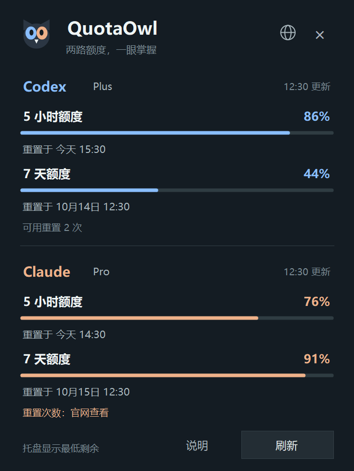

# QuotaOwl 🦉

**Codex 和 Claude 的剩余额度，在 Windows 任务栏里一眼看清。**

一个轻量的 Windows 托盘用量监控工具。只用一个数字显示最低剩余额度，无需一直开着终端或浏览器查询。

[English](README.md) · [直接下载 Windows ZIP](https://github.com/flymm004/quotaowl/releases/download/v0.2.0-alpha.4/QuotaOwl-0.2.0-alpha.4-win-x64.zip) · [版本说明](https://github.com/flymm004/quotaowl/releases/tag/v0.2.0-alpha.4) · [反馈问题](https://github.com/flymm004/quotaowl/issues)

> **当前为 0.2.0-alpha.4 预览版。** Claude 使用客户端内部接口，后续可能变更。旧版 Codex Usage Monitor 仅支持 Codex。

## 界面与功能

### 1. 不开新窗口，也能看到最低剩余额度

**44 表示目前最低的剩余额度为 44%。** 蓝色代表 Codex，暖橙色代表 Claude。这里显示的是下图四项额度中最低的 Codex 周额度。鼠标悬停即可快速查看双方数值。

### 2. 点击数字，查看两个服务的详情

一次看清 5 小时和 7 天额度、重置时间与上次更新时间。右上角地球按钮可切换语言，右下角可手动刷新。

*图片由当前 Windows 界面使用示例数据渲染，不包含真实账户数据。*

### 功能概览

- **托盘只显示一个数字**：比较双方 5 小时、7 天额度，显示最低的剩余百分比。
- **蓝色 Codex，暖橙色 Claude**：数字颜色跟随最低值所属服务。
- **悬停看四项额度，点击开详情**：双方重置时间、读取状态、Codex 可用重置次数集中展示。
- **独立刷新周期**：Codex 每 2 分钟刷新；Claude 每 10 分钟最多查询一次，手动刷新也遵守此间隔。受限时自动延长等待并显示重试时间；额度首次低于 20% 时提醒。
- **八种语言**：英文、简体中文、繁体中文、日语、韩语、西班牙语、德语、法语，也可跟随系统。
- **Windows 原生界面**：按显示器 DPI 缩放，无需安装，无需管理员权限，无额外包依赖。

## 下载和使用

1. 打开 [下载页面](https://github.com/flymm004/quotaowl/releases)，找到 QuotaOwl 版本，展开 **Assets**。
2. 下载 **QuotaOwl-版本号-win-x64.zip**。普通用户不需要下载 **Source code** 源码包。
3. 右键压缩包，选择“**全部解压缩**”，打开解压后的文件夹。
4. 双击 **QuotaOwl.exe**。保留同目录的 **QuotaOwl.exe.config**，用于高 DPI 支持。
5. 在任务栏时钟旁找到数字。若被隐藏，点开托盘折叠菜单，将图标拖到任务栏上。

关闭面板后仍在托盘运行；右键图标选择“退出”可关闭程序。与旧版 Codex Usage Monitor 共用单实例限制，避免重复运行。

### 运行条件

- Windows 10 / 11，64 位，.NET Framework 4.8。
- 使用 Codex：已安装 CLI 或桌面版运行环境，并登录 ChatGPT 订阅账户。
- 使用 Claude：Claude Code 已登录官方订阅账户，必要时运行 **claude auth login**；登录后可关闭终端。
- 可访问额度服务的网络连接。只使用其中一个服务也可以。

## 数字代表什么？

例如 Codex 的两项剩余为 **86% / 44%**，Claude 为 **76% / 91%**，托盘就显示蓝色的 **44**。比较的是剩余百分比，双方额度并未相加，也不能互通。

悬停提示中的 **5h** 代表 5 小时窗口，**7d** 代表 7 天窗口，**\*** 标出托盘当前显示的窗口。黄色小点表示额度低或读取失败。右键菜单会说明数字来自哪个服务、哪个额度窗口。

网络等临时读取失败时，在内存中保留上次成功数值，并在面板与悬停提示中标记“旧数据”；**!** 表示该服务没有可读取的数据。退出登录或切到第三方服务时会移除该服务的旧数值。一方数据缺失时显示目前可用数据中的最低值；双方均无数据时显示 **—**，不误报为零。

## 数据来源与限制

**Codex**：通过已安装 CLI 的本机 App Server 查询，复用现有登录。优先选择桌面版当前的版本化运行文件，避免旧版根目录 codex.exe 影响。服务返回可用重置数时显示次数；没有返回则显示未知。

**Claude**：在内存中使用 Claude Code 现有 OAuth 凭证，查询官方用量服务 **https://api.anthropic.com/api/oauth/usage**。**这是客户端内部接口，后续可能变更。** 本版展示总体 5 小时和 7 天额度，暂不展示模型专属额度。凭证过期时请通过 Claude Code 重新登录；QuotaOwl 不会自行刷新凭证。

Claude 的可用重置权益**暂未自动读取**，面板提供官网用量页入口。通过 CC Switch 切到第三方服务或 API Key 时，会提示无法读取订阅额度。

额度百分比不等于固定的剩余提问次数或任务次数。

Claude 的刷新按钮也遵守 10 分钟间隔。连续收到 HTTP 429 时，依次等待 10、20、40、60 分钟；如果服务返回更长的 `Retry-After`，按服务要求等待。成功读取后恢复正常周期。已有数据会标为旧数据，面板显示下次重试时间；悬停刷新按钮可查看下次 Claude 查询时间。减少请求频次不能保证内部接口始终可用。

登录过期会单独提示。运行 `claude auth login` 后点击刷新；登录失败后检测到凭证文件更新，允许立即重试。QuotaOwl 不会自行续期凭证。

## 隐私

不调用模型，不上传遥测，不保存额度历史，不复制或记录令牌。Claude 凭证只发送到固定的 HTTPS Anthropic 用量接口，禁止跟随重定向。仅保存语言偏好。详见[安全说明](SECURITY.md)。

## 从源码构建

    ./build.ps1 -Version 0.2.0-alpha.4

使用 Windows 的 .NET Framework C# 编译器，生成 ZIP、EXE、配套配置及 SHA-256 文件，位于 **artifacts/**。另见[贡献指南](CONTRIBUTING.md)和[更新记录](CHANGELOG.md)。

## 许可

[MIT](LICENSE)。独立社区工具，与 OpenAI、Anthropic 无隶属关系。
